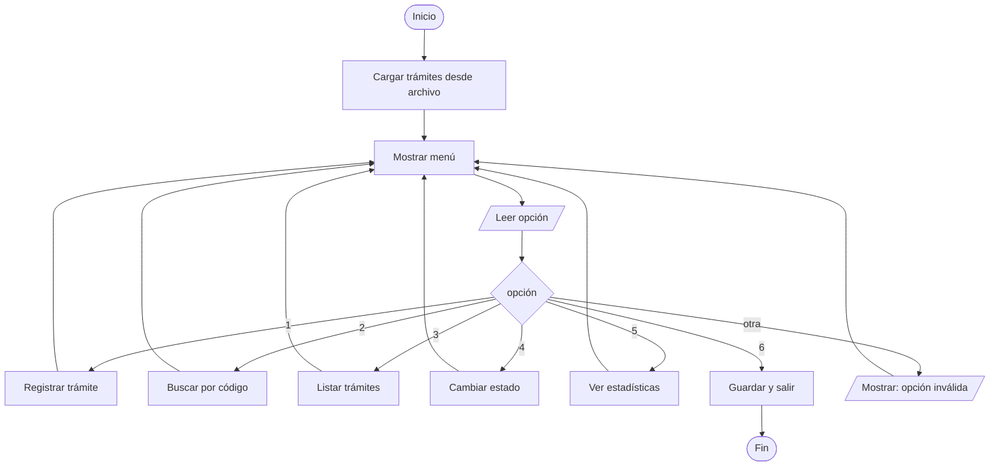
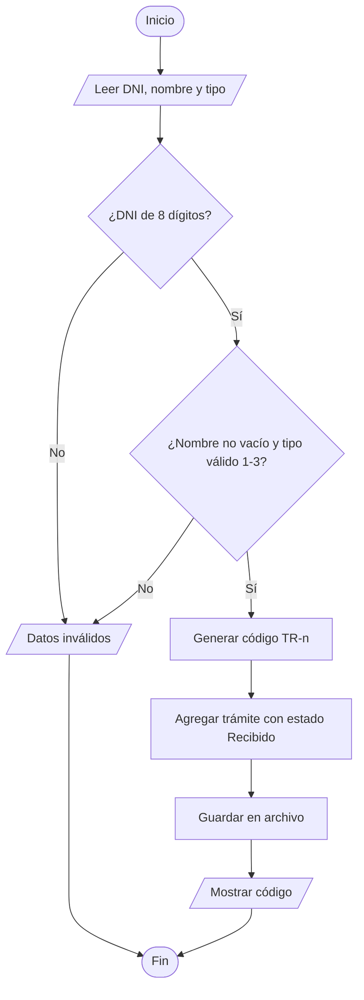

# Etapa 4: Diseño del algoritmo

Sistema de **Mesa de Partes** para registrar y dar seguimiento a trámites de estudiantes
(matrícula, solicitud de notas y registro de estudiante).

## 1. Organización en módulos

| Módulo | Responsabilidad | Funciones principales |
|---|---|---|
| `validaciones.py` | Reglas de validación de datos | `es_digito`, `validar_dni`, `campos_completos`, `validar_estado` |
| `tramites.py` | Lógica de negocio (sin `input`/`print`) | `nombre_tipo`, `generar_codigo`, `registrar_tramite`, `buscar_por_codigo`, `cambiar_estado`, `calcular_estadisticas` |
| `persistencia.py` | Lectura y escritura en archivo CSV | `guardar_tramites`, `cargar_tramites` |
| `main.py` | Interfaz de consola y menú | `mostrar_menu`, `opcion_registrar`, `opcion_buscar`, `opcion_listar`, `opcion_cambiar_estado`, `opcion_estadisticas`, `main` |
| `tests/test_tramites.py` | Pruebas automáticas | casos de prueba por función |

**Por qué esta separación:** la lógica (`tramites.py`) no depende de la consola, así que se puede
probar sin escribir datos a mano y reutilizar si luego se cambia la interfaz (web, GUI).

## 2. Estructura de datos

El pseudocódigo original usaba 5 arreglos paralelos (`codigos`, `dnis`, `nombres`, `tipos`, `estados`).
En Python se conserva la idea de arreglo (lista), pero cada trámite es un diccionario:

```python
{"codigo": "TR-1", "dni": "12345678", "nombre": "Ana Pérez",
 "tipo": "Matrícula", "estado": "Recibido"}
```

Ventaja: un trámite siempre mantiene sus datos juntos y no hay riesgo de desalinear los arreglos.

## 3. Diagrama de flujo (menú principal)



### Diagrama de flujo: registrar trámite



## 4. Pseudocódigo

```
INICIO MesaDePartes
    tramites <- cargar_tramites(archivo)
    REPETIR
        mostrar menú
        leer opcion
        SEGUN opcion
            1: registrar_tramite(tramites)
            2: buscar_por_codigo(tramites)
            3: listar_tramites(tramites)
            4: cambiar_estado(tramites)
            5: ver_estadisticas(tramites)
            6: guardar_tramites(tramites, archivo); mostrar "Saliendo"
            OTRO: mostrar "Opción inválida"
    HASTA opcion = 6
FIN

FUNCION validar_dni(dni)
    SI longitud(dni) <> 8 ENTONCES devolver FALSO
    PARA cada caracter c EN dni
        SI NO es_digito(c) ENTONCES devolver FALSO
    devolver VERDADERO

FUNCION registrar_tramite(tramites, dni, nombre, op)
    tipo <- nombre_tipo(op)
    SI validar_dni(dni) Y campos_completos(nombre, tipo) ENTONCES
        codigo <- "TR-" + (longitud(tramites) + 1)
        agregar {codigo, dni, nombre, tipo, "Recibido"} a tramites
        devolver codigo
    SINO
        devolver NADA

FUNCION calcular_estadisticas(tramites)
    contar trámites por estado: Recibido, En revisión, Entregado
```

## 5. Cambios respecto al pseudocódigo original (PSeInt)

| Original (.psc) | Python | Motivo |
|---|---|---|
| 5 arreglos paralelos de tamaño fijo 100 | lista de diccionarios | sin límite de 100 y sin desalinear datos |
| `nombre_tipo`: cualquier opción ≠ 1, 2 devolvía "Registro de estudiante" | opción fuera de 1-3 se rechaza | evitaba registrar tipos por error de digitación |
| `cambiar_estado` aceptaba cualquier texto | solo "Recibido", "En revisión", "Entregado" | las estadísticas ignoraban estados mal escritos |
| datos solo en memoria | se guardan en `data/tramites.csv` | exigido por la rúbrica (archivos) y evita perder los trámites |
